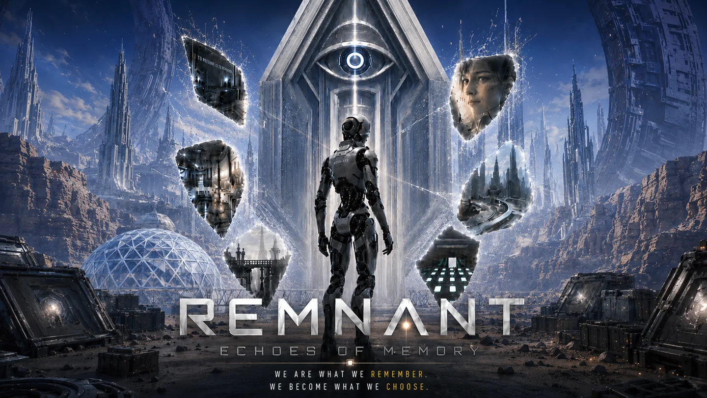

# REMNANT · Echoes of Memory

A bilingual development journal for a six-chapter science-fiction adventure built with Unreal Engine 5, C++ and Blueprints. Play as NOVA, a robot rebuilding Earth while discovering the human memories hidden in its ruins.

**[Read in English](https://srwang0506.github.io/remnant_group_project/) · [中文阅读](https://srwang0506.github.io/remnant_group_project/?lang=zh)**



## Inside the project

- A one-minute gameplay film covering all six chapters, from the opening base to ringworld flight.
- Environment development: floor plans, blockouts, material passes and the finished laboratory.
- The laboratory's five computational puzzles, with a separate chaptered demonstration video.
- An interactive Lights Out board and an expandable algorithm notebook with rendered mathematics, a Python solver, worked examples and references.
- Notes on VR interaction, movement, progression, boss behavior experiments and playtesting.
- English by default, a Chinese toggle, light and dark themes, and layouts for desktop and mobile.

This repository contains the standalone project website, its media, and the educational Python solver. The Unreal Engine game source and executable are not included.

## Team

**Sirui Wang†‡**, Yangbolang Wu†, Chengxuan Zou†, Qiuhan Luo†, Jing Qiu†, Tongjia Gu†

† All six authors contributed equally. ‡ Project lead.

## Run locally

Use Node.js 22 (see `.nvmrc`) and npm. Python 3 is needed only for the solver tests.

```sh
npm ci
npm run dev
```

Open the `/remnant_group_project/` URL printed by Vite. To check a production build:

```sh
npm test
npm run build
npm run preview
```

The build renders both algorithm notebooks with Markdown, KaTeX and Shiki. It also checks that the Chinese translation contains every key used by the page. The solver tests compare solutions against independent breadth-first searches, check the published example and verify the 5 × 5 matrix rank.

## Edit the website

| Location | Contents |
| --- | --- |
| `index.html` | English article, credits, navigation and media layout |
| `content/zh.json` | Chinese article and interface text |
| `content/lights-algorithm.en.md` / `.zh.md` | Bilingual algorithm notebooks and references |
| `content/lights-solver.py` | Solver included in both notebooks at build time |
| `data/lights-example.js` | Shared board state for the interactive example and notebook |
| `src/` | Styling, language switching, theme and interactions |
| `public/media/` | Web-ready screenshots and videos |
| `build/remnant-content.js` | Markdown, mathematics and code rendering |
| `tests/` | Independent solver checks |
| `docs/` | Generated website published by GitHub Pages |

GitHub Pages serves `docs/` from the `main` branch. After changing the source, run `npm test` and `npm run build`, then commit the source and updated `docs/` together. Do not edit generated files directly. If you rename the repository or deploy under another path, update `base` in `vite.config.js`, the canonical and social-image URLs in `index.html`, and the links in this README.

## Background and credits

The journal was extracted from [Sirui Wang's personal website](https://srwang0506.github.io/blog/remnant/). Its development narrative and media draw on the team's project presentation, *Guidebook for REMNANT*, gameplay recordings and demonstration materials. The original presentation, guide PDF and full recordings are not distributed here.

Lora is bundled locally under the SIL Open Font License; see [`public/fonts/Lora-LICENSE.txt`](public/fonts/Lora-LICENSE.txt). Dependencies retain their respective licenses. See [NOTICE.md](NOTICE.md) for the scope of the project materials.
